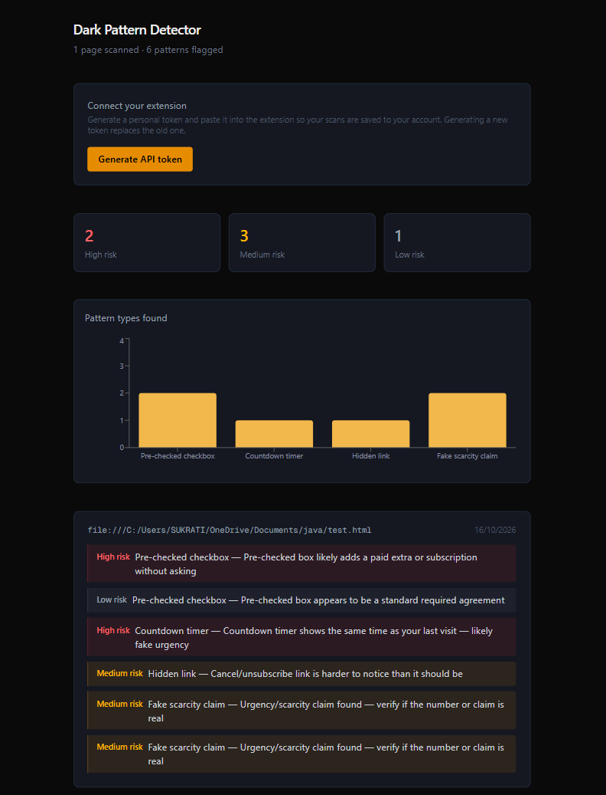
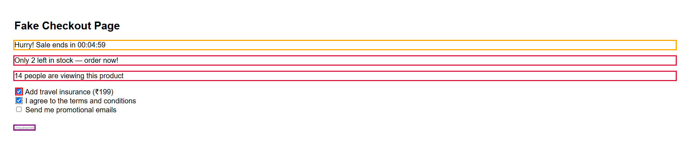
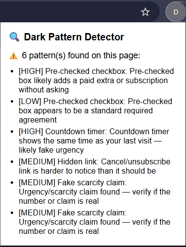
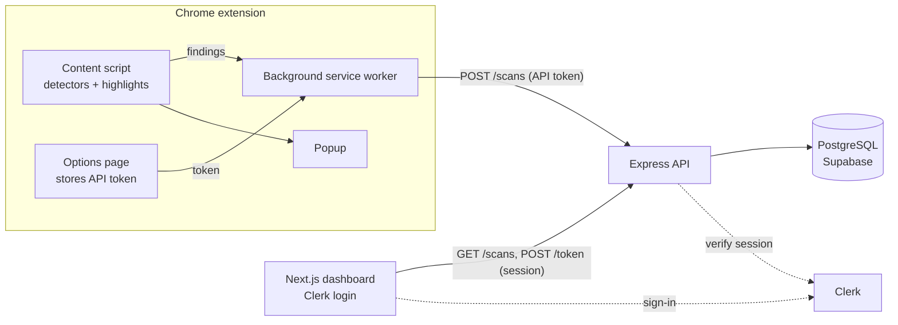

# 🔍 Dark Pattern Detector

A Chrome extension that spots manipulative UX on websites (fake urgency, pre-ticked add-ons, hidden cancel links) and highlights it right on the page. Every scan is saved to a personal dashboard so you can see which patterns you run into most.

Built solo as a full-stack project: browser extension, REST API, PostgreSQL database, authenticated Next.js dashboard.



## What it does

When you open a page, the extension scans it and outlines anything suspicious, with a plain-language explanation on hover. The popup summarises what was found, and the dashboard keeps your scan history, risk counts, and a chart of the most common pattern types.




### Patterns detected

| Pattern | How it is detected | Confidence logic |
|---|---|---|
| **Pre-checked checkboxes** | Finds ticked `<input type="checkbox">` and reads the label text | **High** for paid extras (insurance, subscriptions, newsletters, warranties). **Low** for ordinary agreements (terms, policy). **Medium** otherwise |
| **Countdown timers** | Matches `HH:MM:SS` text and remembers the last value seen per site | **High** if the timer shows the same value as your previous visit (likely fake urgency). **Low** otherwise, since it may be a real sale |
| **Hidden cancel / unsubscribe links** | Finds cancel-style wording, then checks computed styles | **High** if the text is both tiny and low-contrast, **medium** if only one |
| **Fake scarcity claims** | Regex over phrases like "only 3 left", "12 people are viewing" | **Medium**, because the claim can't be verified from one page load |

Every finding is stored as `{ type, confidence, reason }`, so the dashboard can explain *why* something was flagged rather than just saying that it was.

## Architecture



**Two kinds of credentials, on purpose.** The dashboard authenticates with a Clerk session. The extension can't share that session, so each user generates a personal API token on the dashboard and pastes it into the extension's options page. The same pattern is used by tools like the GitHub CLI.

## Tech stack

- **Extension:** Chrome Manifest V3, vanilla JavaScript (content script, service worker, popup, options page), `MutationObserver`
- **Backend:** Node.js, Express, `pg`
- **Database:** PostgreSQL on Supabase (JSONB for findings, row level security enabled)
- **Auth:** Clerk (dashboard login and session verification)
- **Dashboard:** Next.js (App Router), Tailwind CSS, Recharts

## Design decisions worth knowing about

- **Network calls go through the background service worker, not the content script.** Content scripts run in the host page's origin, so Chrome's Private Network Access rules blocked them from reaching the local API when the page was a public site. The service worker runs in the extension's own origin and has explicit host permission, which is the standard fix.
- **API tokens are stored hashed (SHA-256).** The plain token is shown once at creation. A database leak would not expose usable tokens.
- **All data is scoped by `user_id`.** The scans endpoint filters on the authenticated user, so one account can never read another's scans.
- **Dynamic pages are handled with a debounced `MutationObserver`.** Detectors re-run as new content renders (common on React and Vue sites), then stop after a few seconds so infinite-scroll pages don't cause endless scanning.
- **Empty scans are not saved.** Only pages with at least one finding are sent to the backend.

## Getting started

### Prerequisites

- Node.js 20 or newer
- Google Chrome
- A free [Supabase](https://supabase.com) project
- A free [Clerk](https://clerk.com) application (enable Email and/or Google sign-in)

### 1. Clone

```bash
git clone https://github.com/sukrativerma/dark-pattern-detector.git
cd dark-pattern-detector
```

### 2. Create the database tables

In Supabase, open **SQL Editor** and run:

```sql
CREATE TABLE scans (
  id SERIAL PRIMARY KEY,
  url TEXT NOT NULL,
  findings JSONB NOT NULL,
  created_at TIMESTAMPTZ DEFAULT NOW(),
  user_id TEXT
);
CREATE INDEX idx_scans_user_id ON scans(user_id);

CREATE TABLE api_tokens (
  id SERIAL PRIMARY KEY,
  user_id TEXT NOT NULL UNIQUE,
  token_hash TEXT NOT NULL UNIQUE,
  created_at TIMESTAMPTZ DEFAULT NOW()
);

ALTER TABLE scans ENABLE ROW LEVEL SECURITY;
ALTER TABLE api_tokens ENABLE ROW LEVEL SECURITY;
```

### 3. Start the backend

```bash
cd backend
npm install
```

Create `backend/.env`:

```
DATABASE_URL=your_supabase_session_pooler_connection_string
CLERK_PUBLISHABLE_KEY=your_clerk_publishable_key
CLERK_SECRET_KEY=your_clerk_secret_key
```

Use the **Session pooler** connection string from Supabase's **Connect** panel. The direct connection host does not resolve on some home networks.

```bash
node server.js
```

The API runs on `http://localhost:3001`.

### 4. Start the dashboard

```bash
cd dashboard
npm install
```

Create `dashboard/.env.local`:

```
NEXT_PUBLIC_CLERK_PUBLISHABLE_KEY=your_clerk_publishable_key
CLERK_SECRET_KEY=your_clerk_secret_key
```

```bash
npm run dev
```

The dashboard runs on `http://localhost:3000`.

### 5. Load the extension

1. Open `chrome://extensions` and turn on **Developer mode**.
2. Click **Load unpacked** and select the `extension/` folder.
3. On the dashboard, sign in and click **Generate API token**. Copy it right away, since it is only shown once.
4. Open the extension's **Options** page, paste the token, and save.
5. Browse to any page. Detected patterns are outlined on the page, and the scan appears on your dashboard.

## Known limitations

This is a rule-based detector, so its coverage has honest limits:

- It reads **text and DOM structure**. Urgency shown as an image or canvas can't be detected.
- Sites that build checkboxes from styled `<div>`s rather than real `<input>` elements are missed.
- Scarcity detection depends on specific phrasing, so unusual wording won't match.
- A page with none of the four supported patterns correctly reports no findings.
- Confidence levels are heuristics. A "low" countdown timer may be a genuine sale.

## Roadmap

- Deploy the API and dashboard, and switch the extension to the hosted URL
- More detectors: confirmshaming ("No thanks, I don't like saving money"), forced continuity, nagging pop-ups
- Per-detector toggles and a trusted-sites list in the options page
- Filtering and search on the dashboard
- User feedback on findings ("was this actually manipulative?") to tune the heuristics

## Author

Built by [@sukrativerma](https://github.com/sukrativerma).
